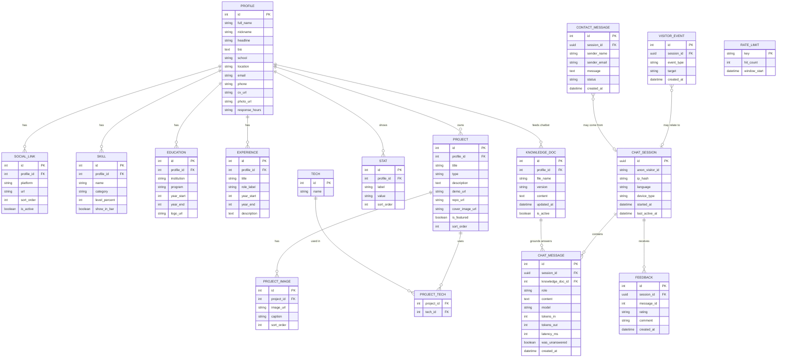
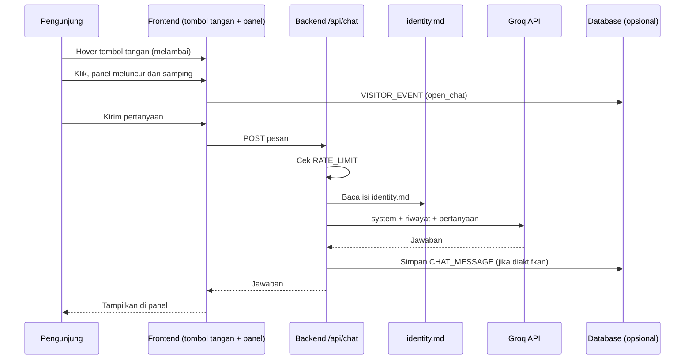

# ERD — Portofolio Attaya Arkarna + Chatbot Tangan Melambai

Dokumen ini menggambarkan model data untuk website portofolio dan fitur chatbot. Diagram memakai sintaks **Mermaid** (tampil otomatis di GitHub, VS Code dengan ekstensi Mermaid, dan Notion).

> **Catatan privasi:** tabel `chat_session` dan `chat_message` bersifat **opsional**. Secara default percakapan tidak perlu disimpan. Aktifkan hanya jika Attaya ingin menganalisis kualitas jawaban, dan beri tahu pengunjung.

---

## 1. Diagram

---

## 2. Penjelasan Entitas

| Entitas | Fungsi | Catatan |
|---|---|---|
| `PROFILE` | Data utama Attaya (nama, bio, kontak, CV) | Satu baris saja (satu pemilik) |
| `SOCIAL_LINK` | Link Instagram, LinkedIn, GitHub, Facebook | **Satu sumber data** untuk header, hero, dan footer agar tidak ada URL ganda |
| `SKILL` | Daftar skill dan level persen | `show_in_bar` menentukan skill tampil di progress bar atau hanya di daftar "Mastered Skills" |
| `EDUCATION` | Riwayat sekolah | Perlu dirapikan tahunnya (lihat PRD) |
| `EXPERIENCE` | Pengalaman (UI Design, Web Developing) | |
| `STAT` | Statistik di About Me (10+, 80%, 89%) | |
| `PROJECT` | Proyek (Meowketplace, Sgarage, Eyfy) | `type`: website / figma |
| `TECH`, `PROJECT_TECH` | Teknologi per proyek (relasi many-to-many) | |
| `PROJECT_IMAGE` | Galeri gambar proyek | |
| `KNOWLEDGE_DOC` | Menyimpan isi `identity.md` dan versinya | Bisa juga cukup dibaca dari file; tabel ini hanya perlu jika ingin versi dan riwayat |
| `CHAT_SESSION` | Satu sesi percakapan anonim | Simpan **hash** IP, bukan IP asli |
| `CHAT_MESSAGE` | Pesan pengguna dan AI | `was_unanswered` menandai pertanyaan yang AI tidak tahu, berguna untuk melengkapi `identity.md` |
| `FEEDBACK` | Jempol atas/bawah untuk jawaban | Opsional |
| `CONTACT_MESSAGE` | Pesan dari form "Message Me" | `status`: new / read / replied |
| `VISITOR_EVENT` | Klik tombol tangan, buka chat, download CV, klik kontak | Untuk analitik ringan |
| `RATE_LIMIT` | Penghitung pembatasan pesan per IP/sesi | Bisa disimpan di memori/Redis, tidak harus di database utama |

---

## 3. Relasi Utama

| Relasi | Kardinalitas | Arti |
|---|---|---|
| `PROFILE` – `SOCIAL_LINK` / `SKILL` / `EDUCATION` / `EXPERIENCE` / `PROJECT` / `STAT` | 1 : N | Satu profil punya banyak item |
| `PROJECT` – `TECH` (lewat `PROJECT_TECH`) | M : N | Satu proyek memakai banyak teknologi, satu teknologi dipakai banyak proyek |
| `CHAT_SESSION` – `CHAT_MESSAGE` | 1 : N | Satu sesi berisi banyak pesan |
| `KNOWLEDGE_DOC` – `CHAT_MESSAGE` | 1 : N | Versi pengetahuan yang dipakai saat menjawab |
| `CHAT_SESSION` – `CONTACT_MESSAGE` | 1 : 0..N | Pesan kontak bisa berasal dari sesi chat (misalnya setelah AI mengarahkan ke form) |

---

## 4. Alur Data Chatbot

---

## 5. Opsi Implementasi

| Opsi | Cocok untuk | Catatan |
|---|---|---|
| **Tanpa database** | Versi awal yang paling sederhana | `PROFILE`, `SKILL`, `PROJECT`, dan lainnya disimpan sebagai satu file JSON; chat tidak disimpan |
| **Firebase Firestore** | Sudah ada di daftar skill Attaya | Koleksi per entitas; cocok untuk `CHAT_MESSAGE`, `CONTACT_MESSAGE`, `VISITOR_EVENT` |
| **Supabase / PostgreSQL** | Jika ingin relasi dan query yang rapi | Diagram di atas bisa langsung dijadikan skema SQL |

**Saran:** mulai tanpa database (JSON + `identity.md`), lalu tambahkan Firestore hanya untuk `CONTACT_MESSAGE` dan log chat anonim ketika dibutuhkan.

---

## 6. Aturan Data dan Privasi

- Jangan menyimpan IP asli; simpan hash (`ip_hash`).
- Jangan menyimpan data identitas pengunjung kecuali yang mereka isi sendiri di form kontak.
- Sediakan pemberitahuan singkat di panel chat jika percakapan dicatat.
- Batasi masa simpan log chat (misalnya 30–90 hari) lalu hapus otomatis.
- Pertanyaan dengan `was_unanswered = true` ditinjau berkala untuk melengkapi `identity.md`.